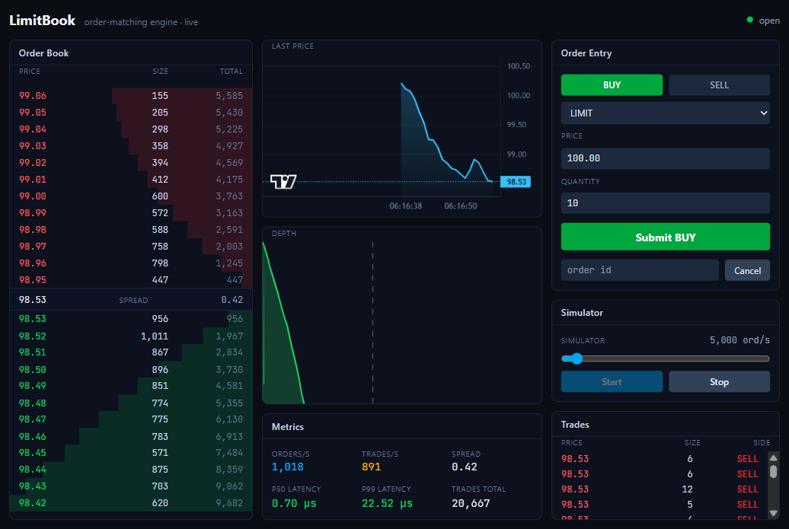

# LimitBook — Advanced Order-Matching Engine (Java)

A production-grade, price-time-priority **order-matching engine** (the core of a
stock/crypto exchange) with a real-time web trading terminal.

- **Engine core** — pure Java 21, zero framework/IO deps, single-writer matcher.
- **Gateway** — Spring Boot 3: REST intake, WebSocket market data, Prometheus
  metrics, synthetic order-flow simulator.
- **Frontend** — React + TypeScript + Tailwind + lightweight-charts trading UI.



## Headline numbers (measured, single thread, Temurin 21)

| Metric | Result | Target |
|--------|--------|--------|
| Throughput | **≈ 2.44 M orders/sec** | ≥ 1 M |
| Match latency p50 / p99 | **0.10 µs / 0.40 µs** | p99 < 100 µs |
| Match latency p999 | **6.2 µs** | — |

Full method + reproduction in [`engine-core/BENCHMARKS.md`](engine-core/BENCHMARKS.md).
Tests: **68 green** (engine 61 incl. jqwik properties, gateway 7 integration);
matcher **100%** line coverage.

## Architecture

```
┌─────────────────────────────────────────────┐
│  FRONTEND (React + TS + Tailwind)            │
│  L2 book · depth chart · trade tape          │
│  order entry · metrics · simulator controls  │
└───────────────▲─────────────────────────────┘
                │ WebSocket (read) + REST (write)
┌───────────────┴─────────────────────────────┐
│  GATEWAY (Spring Boot)                       │
│  REST intake · 30fps WS broadcast · metrics  │
└───────────────▲─────────────────────────────┘
                │ in-process bounded queue (no network)
┌───────────────┴─────────────────────────────┐
│  ENGINE CORE (pure Java, zero deps)          │
│  order book · matcher · single-writer loop   │
└──────────────────────────────────────────────┘
```

The core has no Spring/network/IO dependencies; the gateway wraps it; the UI only
reads engine state. See [`DESIGN.md`](DESIGN.md) for the data-structure and
single-writer rationale.

## Matching rules

Price priority (best price first), then FIFO time priority within a level. The
maker sets the trade price, so aggressors get price improvement. Order types:
**LIMIT, MARKET, IOC, FOK, POST_ONLY, STOP, STOP_LIMIT**, plus cancel and amend
(amend keeps priority only on a pure quantity decrease). Self-trade prevention is
configurable (cancel-newest / cancel-oldest / decrement / none). Prices are
integer ticks (1 tick = $0.01) — never floats.

## Run it

### Prerequisites
Java 21, Maven 3.9+, Node 20+ (24 used here).

### Tests + benchmark
```bash
mvn test                          # all unit + property + integration tests
mvn -pl engine-core test-compile dependency:build-classpath -Dmdep.outputFile=cp.txt -Dmdep.includeScope=test
java -cp "engine-core/target/classes;engine-core/target/test-classes;$(cat engine-core/cp.txt)" \
     com.limitbook.engine.bench.MatchingBenchmark
```

### Dev (two terminals)
```bash
mvn -pl gateway -am spring-boot:run          # gateway on :8080
cd frontend && npm install && npm run dev     # UI on :5173 (proxies to :8080)
```
Open http://localhost:5173 and click **Start** under Simulator.

### Docker (both services)
```bash
docker compose up --build
# UI on http://localhost:8088, gateway on http://localhost:8080
```

## API

| Method | Path | Purpose |
|--------|------|---------|
| POST | `/api/orders` | submit (202 + assigned id; results stream over WS) |
| DELETE | `/api/orders/{id}` | cancel |
| PUT | `/api/orders/{id}` | amend (price, quantity) |
| GET | `/api/book` | current L2 snapshot |
| GET | `/api/trades?limit=N` | recent trades |
| POST | `/api/sim/start?rate=N` | start synthetic flow |
| POST | `/api/sim/stop` | stop simulator |
| GET | `/actuator/prometheus` | metrics |
| WS | `/ws` | coalesced market-data frames (~30 fps) |

## Layout

```
engine-core/   pure-Java matcher, book, single-writer service, JMH bench
gateway/       Spring Boot REST + WebSocket + metrics + simulator
frontend/      React + TS trading terminal
```

## License

MIT — see [LICENSE](LICENSE).
